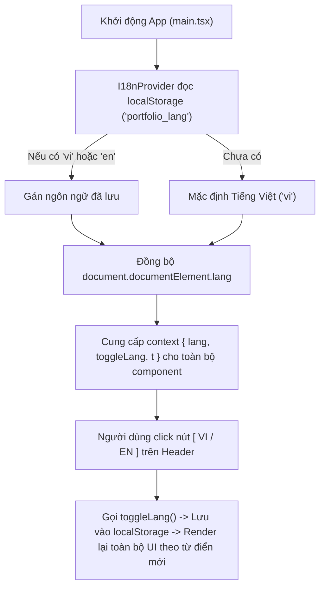

# Hệ thống Đa ngôn ngữ (i18n) & Đồng nhất Ngôn ngữ Portfolio

Tài liệu kỹ thuật giải thích kiến trúc, cấu trúc từ điển và luồng hoạt động của hệ thống đa ngôn ngữ (Tiếng Việt & Tiếng Anh) trên Portfolio "The Impossible Chalkboard".

---

## 1. Mục đích

- **Loại bỏ hoàn toàn tình trạng pha trộn ngôn ngữ ("nửa nạc nửa mỡ")**: Trước đây, template Figma ban đầu chứa nhiều nhãn tiếng Anh, trong khi các phần dự án bổ sung được viết bằng tiếng Việt, gây mất tính nhất quán và khó chịu cho người xem.
- **Đồng nhất 100% trải nghiệm**: Toàn bộ nội dung từ 5 chương (Hero, About, Selected Works, Growth, Contact), thanh điều hướng, modal liên hệ, ghi chú bảng đen cho tới các chú thích timeline video đều được chuyển đổi đồng bộ giữa Tiếng Việt và Tiếng Anh.
- **Duy trì tùy chọn người dùng**: Ghi nhớ ngôn ngữ đã chọn vào `localStorage` (`portfolio_lang`) và đồng bộ thẻ `<html lang="...">` chuẩn trợ năng & SEO.

---

## 2. Cấu trúc thư mục module

```text
src/assets/i18n/
├── types.ts      # Định nghĩa TypeScript interface chuẩn: TranslationDictionary
├── vi.ts         # Từ điển tiếng Việt hoàn chỉnh (mặc định)
├── en.ts         # Từ điển tiếng Anh tương ứng chuẩn phong cách editorial
└── index.tsx     # I18nProvider, useI18n hook và logic lưu trữ localStorage
```

---

## 3. Danh sách các file liên quan

1. [src/assets/i18n/types.ts](file:///c:/Users/baold/Desktop/Portfolio/src/assets/i18n/types.ts): Định nghĩa kiểu dữ liệu cho toàn bộ các phần: `common`, `chaptersList`, `hero`, `about`, `selectedWorks`, `growth`, `contact`, `modal`.
2. [src/assets/i18n/vi.ts](file:///c:/Users/baold/Desktop/Portfolio/src/assets/i18n/vi.ts): Nội dung tiếng Việt giàu chất tự sự, kỹ thuật thực tế và sắc sảo.
3. [src/assets/i18n/en.ts](file:///c:/Users/baold/Desktop/Portfolio/src/assets/i18n/en.ts): Nội dung tiếng Anh tự nhiên, mượt mà và giữ nguyên tinh thần nghệ thuật bảng đen.
4. [src/assets/i18n/index.tsx](file:///c:/Users/baold/Desktop/Portfolio/src/assets/i18n/index.tsx): React Context Provider cung cấp `lang`, `toggleLang`, `setLang` và từ điển bản dịch `t`.
5. [src/main.tsx](file:///c:/Users/baold/Desktop/Portfolio/src/main.tsx): Điểm khởi chạy của ứng dụng, bọc toàn bộ `<App />` bên trong `<I18nProvider>`.
6. [src/App.tsx](file:///c:/Users/baold/Desktop/Portfolio/src/App.tsx): Tiêu thụ `useI18n()`, render nhãn header, nút đổi ngôn ngữ `[ VI / EN ]`, và truyền nội dung vào 5 chương.
7. [src/ChapterNavigation.tsx](file:///c:/Users/baold/Desktop/Portfolio/src/ChapterNavigation.tsx): Thanh điều hướng tiến trình với nhãn chương và chữ chạy dọc dynamic.
8. [src/SelectedWorks.tsx](file:///c:/Users/baold/Desktop/Portfolio/src/SelectedWorks.tsx): 3 dự án trọng tâm video 16:9 + 4 dự án bổ trợ, render theo từ điển hiện tại.

---

## 4. Luồng hoạt động (Data Flow & UI Flow)



### Các bước cụ thể:
- **Bước 1 (Khởi tạo):** Khi component mount, `I18nProvider` kiểm tra `localStorage.getItem('portfolio_lang')`. Nếu chưa có, gán mặc định `'vi'`.
- **Bước 2 (Gán thẻ HTML):** Cập nhật thuộc tính `document.documentElement.lang = lang` mỗi khi ngôn ngữ thay đổi.
- **Bước 3 (Render giao diện):** Mọi component gọi `const { t, lang, toggleLang } = useI18n()` để lấy dữ liệu văn bản.
- **Bước 4 (Tương tác nút bấm):** Nút `.lang-toggle-btn` hiển thị trên navigation header, bấm vào sẽ đảo giữa `'vi'` và `'en'` tức thì.

---

## 5. Lưu ý cho người sau khi bảo trì hoặc mở rộng

1. **Tuyệt đối không hardcode text**: Bất kỳ chuỗi ký tự nào hiển thị ra giao diện đều phải được đưa vào `types.ts`, `vi.ts` và `en.ts`.
2. **Đảm bảo tính đối xứng**: Khi thêm 1 field vào `types.ts`, TypeScript sẽ yêu cầu cả `vi.ts` và `en.ts` phải có key đó thì mới pass build (`npm run build`).
3. **Giữ định dạng JSX chuẩn**: Tuân thủ quy tắc mỗi thẻ 1 dòng, 2-space indent và gắn comment ý nghĩa UI trên mỗi block.
